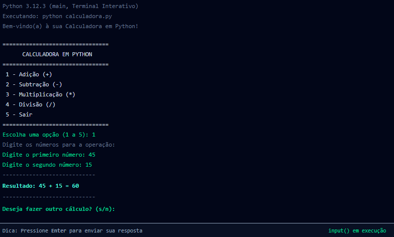
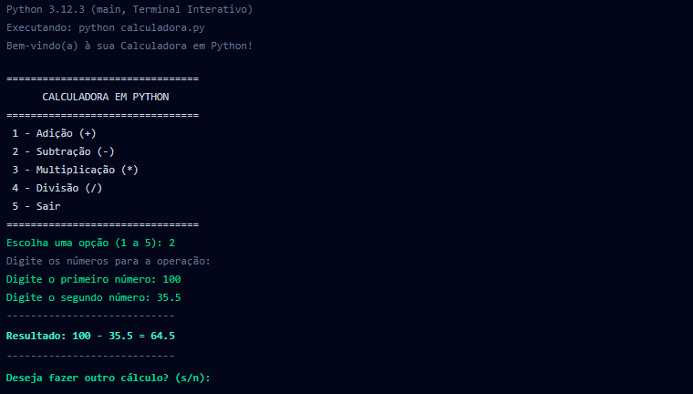
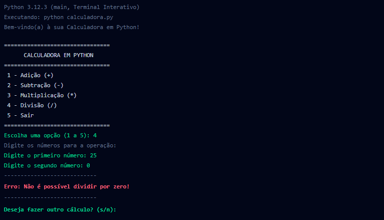

# 🧮 Calculadora em Python

Calculadora de terminal com as quatro operações básicas (adição, subtração, multiplicação e divisão), desenvolvida com auxílio do Google AI Studio como parte do **Desafio 1: Criando sua primeira aplicação com IA**.

## Funcionalidades

- Menu com as operações numeradas
- Aceita números inteiros e decimais
- Avisa quando o usuário digita um valor inválido e pede novamente
- Impede a divisão por zero com uma mensagem amigável
- Permite fazer vários cálculos seguidos

## Como executar

1. Instale o [Python 3](https://www.python.org/downloads/)
2. Baixe o arquivo `calculadora.py`
3. No terminal, dentro da pasta do arquivo, execute:

```bash
python calculadora.py
```

> No macOS e no Linux, se `python` chamar uma versão antiga, use `python3 calculadora.py`.

## Exemplos de uso

**Soma**



**Subtração com números decimais**



**Divisão por zero**



## Como o código funciona

### 1. Quais são os principais componentes do código?

O código é dividido em partes pequenas, cada uma com uma responsabilidade:

| Componente | Função | Para que serve |
|---|---|---|
| Operações matemáticas | `somar`, `subtrair`, `multiplicar`, `dividir` | Recebem dois valores (`a` e `b`) e devolvem o resultado com `return` |
| Interface com o usuário | `exibir_menu()` | Mostra as opções de 1 a 5 no terminal com `print()` |
| Entrada segura | `obter_numero(mensagem)` | Lê o número digitado e evita que o programa trave se o usuário digitar letras |
| Controle do programa | `main()` e `if __name__ == "__main__":` | Define a ordem de execução, repete o menu e encerra quando o usuário escolhe sair |

Separar as operações em funções deixa o código organizado e facilita corrigir ou testar uma parte sem mexer no resto.

### 2. Como a aplicação recebe os números e identifica a operação?

**Operação:** o programa lê a escolha do usuário com `input()`. O método `.strip()` remove espaços sem querer, e uma verificação confere se a opção está entre 1 e 4. Se não estiver, o `continue` volta ao menu.

```python
opcao = input("Escolha uma opção (1 a 5): ").strip()
```

**Números:** a função `obter_numero()` é chamada duas vezes, uma para cada número. O `input()` entrega o dado como texto, então ele é convertido com `float()`, o que permite usar números como `10`, `3.5` ou `-2.4`. Se a conversão falhar (por exemplo, ao digitar "dez"), o `try / except ValueError` mostra um aviso e pergunta de novo, sem fechar o programa.

### 3. Como a lógica de programação faz os cálculos e mostra os resultados?

- **Decisão:** uma estrutura `if / elif / else` olha a opção escolhida e chama a função certa, guardando o valor em `resultado`.

  ```python
  if opcao == "1":
      resultado = somar(num1, num2)
  elif opcao == "2":
      resultado = subtrair(num1, num2)
  # ... e assim por diante
  ```

- **Cálculo:** `num1` e `num2` são enviados para os parâmetros `a` e `b` da função, que faz a conta e devolve o valor com `return`.

- **Divisão por zero:** dentro de `dividir()`, o código confere `if b == 0` antes de calcular. Se for zero, devolve uma mensagem de erro em vez de deixar o Python gerar um `ZeroDivisionError`. Na hora de mostrar, `isinstance(resultado, str)` identifica se o retorno é uma mensagem de erro ou um número.

- **Apresentação:** o resultado é exibido com **f-strings**, que colocam o valor das variáveis direto no texto:

  ```python
  print(f"Resultado: {num1} + {num2} = {resultado}")
  ```

- **Repetição:** um laço `while True` mantém o programa funcionando. Ao final de cada conta, ele pergunta se o usuário quer continuar (`s/n`). Se a resposta não for `s`, o `break` encerra o laço e o programa termina.

## Tecnologias

- Python 3
- Google AI Studio (geração do código)
